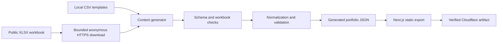

# Content Pipeline

Smart Portfolio turns spreadsheet rows into validated JSON before Next.js renders any portfolio page. The browser never downloads or parses the workbook. Deployable content is fetched, validated, built, and deployed as one immutable candidate snapshot.

Use this guide for source selection, generation, hashing, and deployment semantics. See [Content Sheet Schema](CONTENT_SHEET_SCHEMA.md) for the exact columns and field rules, [Content Mapping](CONTENT_MAPPING.md) for selectors and UI consumers, and [Local Content Editing](LOCAL_CONTENT_EDITING.md) for the editing workflow.

## Pipeline overview



The generator is `scripts/fetchPortfolioContent.ts`. Workbook-specific checks and content hashing live in `scripts/lib/portfolioContentGeneration.ts`. Shared normalization and content validation live under `src/lib/content/`.

## Source modes

Two environment variables control source selection:

- `PORTFOLIO_WORKBOOK_URL`: one anonymously downloadable HTTPS XLSX URL.
- `PORTFOLIO_REQUIRE_REMOTE_CONTENT`: strict-mode switch. Only the exact string `true` enables it.

The current generator behaves as follows:

| Workbook URL | Strict mode | Result |
| --- | --- | --- |
| Blank | `false` or unset | Read all checked-in CSV templates. |
| Blank | `true` | Fail before reading templates. |
| Present and valid | Either value | Download and use all nine workbook tabs. |
| Present but invalid, unavailable, or malformed | Either value | Fail without template fallback. |

There is no per-sheet URL, CSV download mode, or per-tab fallback. Supplying a workbook URL selects the remote path for the complete public workbook. A failed configured download never falls back to local content, even when strict mode is false.

The Projects gallery keeps this source contract. Its five-row [project import](../../src/content/templates/projects.csv) must also replace the live workbook's existing `projects` rows before a deployment candidate can show the new lineup. Local visuals do not inject missing records into remote content; see [Project showcase](PROJECT_SHOWCASE.md#workbook-publication-handoff).

Generated metadata declares `sourceMode` as `templates` when all nine public sheets are local and `remote` when all nine come from the workbook. The type also permits `mixed`, but the current all-or-nothing public source selection cannot emit that mode.

The generator also requires the checked-in `resume.csv` compatibility template to remain header-only. It reads that local guard file in both source modes, never downloads resume content, and never accepts a `resume` worksheet in the remote workbook.

When the command runs directly, it loads the ignored root `.env` file if present. Existing process environment values and the tracked `.env.example` define the supported configuration boundary.

## Remote download boundary

The remote path accepts exactly one complete workbook snapshot. It can make at most two independent requests so one transient source failure does not discard an otherwise valid deployment candidate:

- The initial URL and every redirect target must use HTTPS, have no username, password, or non-default port, and name a DNS hostname rather than a local, private, reserved, or IP-literal destination.
- Redirects are handled manually. A chain permits at most five redirects, requires a non-empty `Location`, rejects cycles, validates each resolved target before requesting it, and never accepts an HTTPS downgrade.
- Each hop resolves all DNS answers under the same attempt deadline. The build-only Node HTTPS transport rejects the hop if any answer is not conservatively public, then pins one validated answer in its connection lookup. It retains the original hostname for the `Host` header, SNI, and normal TLS certificate validation, so the connection performs no later DNS lookup for that hop.
- Fetch credentials are omitted, no authorization or cookie header is added, and the request advertises XLSX and generic binary responses through `Accept`.
- Each attempt has a 15-second deadline covering DNS resolution, every redirect response, response headers, and the complete capped body.
- A retryable failure waits one fixed second before one final attempt, for a maximum 31-second download window. Each attempt uses a fresh request and never combines bytes from different responses.
- The maximum compressed response size is 5 MiB. A non-empty `Content-Length` must parse as a non-negative safe integer or generation fails. The declared size and the streamed or fallback body size are each enforced.
- Deadlines, network or stream interruptions, HTTP 408, HTTP 429, and HTTP 5xx responses are retryable. Other HTTP 4xx responses and invalid length or size boundaries fail immediately.
- Download failures use generic errors that do not include the configured URL. Rejected response and stream bodies, including late responses, are cancelled on a best-effort, non-blocking basis, and partial bytes are discarded.

Payload validation rejects a `text/html` response type, common HTML or login content at the start of the body, and data without a ZIP signature. Before ExcelJS receives any workbook bytes, JSZip reads the ZIP central directory and streams every non-directory resolved archive entry to measure decoded output. The archive permits at most 128 resolved entries, 16 MiB decoded per entry, and 32 MiB decoded across all entries; the measurement does not trust ZIP-advertised uncompressed sizes. ExcelJS must then parse the bounded bytes as a valid, non-empty XLSX workbook. The response MIME type is not an allowlist by itself. A non-HTML MIME type can proceed only when the ZIP and XLSX checks also succeed.

The workbook is intentionally anonymous public input. Secret storage in GitHub Actions is used for runner-log redaction, not authentication. Public-address validation and DNS pinning constrain where the configured workbook client connects; they do not establish that an arbitrary public hostname is an approved content publisher. A reviewed hostname allowlist remains a separate source-governance decision if the provider set becomes stable.

The address filter is a conservative defensive policy. It rejects IPv4 special-use, private, loopback, link-local, documentation, multicast, and reserved ranges. For IPv6, it admits only `2000::/3` after excluding IANA special-purpose blocks within that range, including `2001::/23`, `2001:db8::/32`, `2002::/16`, and `3fff::/20`; mapped, translated, unique-local, site-local, link-local, and reserved-family addresses are outside that allowance.

## Workbook structure checks

The workbook must contain exactly these nine visible tabs:

1. `profile`
2. `links`
3. `research`
4. `projects`
5. `experience`
6. `recommendations`
7. `education`
8. `skills`
9. `site_settings`

Each title is matched with `title.trim().toLowerCase()`. Capitalization, surrounding whitespace, and physical tab order do not matter. Internal spaces, punctuation, hyphens, and spelling are not normalized aliases.

Generation rejects:

- a missing or unexpected tab;
- an explicit `resume` tab;
- duplicate normalized tab names;
- hidden or very-hidden tabs;
- any workbook whose total tab count is not exactly nine.

Each worksheet is limited to 5,000 rows, 128 columns, and 250,000 row-by-column cells. These limits are checked against ExcelJS worksheet dimensions before row conversion.

## Headers, rows, and formulas

Every sheet has an exact header set defined in `scripts/lib/portfolioContentGeneration.ts` and documented in [Content Sheet Schema](CONTENT_SHEET_SCHEMA.md). Header order is flexible, but header names are trimmed, case-sensitive, unique, and must match the required lowercase set exactly. Extra or missing headers fail generation.

Row conversion uses displayed cell text:

- Empty rows and harmless trailing blank rows or columns are ignored.
- A non-empty cell beyond the declared schema is a malformed row.
- Windows and legacy carriage-return line endings normalize to `\n`.
- Outer whitespace is trimmed during CSV-compatible parsing and field normalization. Meaningful internal whitespace is preserved.
- Formula cells are accepted only when the workbook contains a cached result. The displayed cached text is used. A formula without a cached result fails generation.

The `profile` and `site_settings` workbook tabs accept only their explicit key allowlists and reject duplicate keys.

Local CSV templates use the same exact headers, row normalization, key allowlists, and duplicate-key checks as the workbook path. `profile.timezone` and its legacy `time_zone` alias resolve to the same canonical field, so they cannot appear together. Collection IDs are validated in both modes.

## Normalization and validation

Generation applies four layers:

1. Parse and validate the exact CSV-equivalent sheet structure.
2. Normalize keys, booleans, numbers, lists, links, optional values, and supported date settings.
3. Validate required fields, unique IDs, references, grouped fields, URLs, and content invariants.
4. Import and validate the generated JSON again through `getPortfolioContent()` during the static build.

The parser boundary is an adapter seam: a checked-in CSV set or one validated workbook can produce the same `RawPortfolioSheets` input, but only this build-time adapter may read either source. New authoring sources must implement the same bounded, exact-header, canonical-key validation before normalization; they must not add a browser fetch, a runtime CMS client, or a second generated-content format.

Important normalization rules include:

- Blank optional text becomes absent from JSON.
- Blank list fields become empty arrays.
- Pipe-delimited items are trimmed and empty items are removed.
- Booleans accept `true`, `false`, `yes`, `no`, `1`, and `0`, case-insensitively. A blank row boolean defaults to `false`.
- Numbers must be finite, but the normalizer does not require integers or non-negative values.
- `legal_effective_date` accepts a real ISO date or converts a valid `M/D/YYYY` or `MM/DD/YYYY` display value to ISO before validation.
- Other date-like content fields remain strings. Their recommended formats are UI conventions, not generator-level calendar validation.
- Project Home skills accept at most three ordered entries and require each optional summary/details pair together.
- Skill popup copy requires `proficiency`, `summary`, and `where_used` together.
- Research graphical abstracts and videos must use allowlisted, root-relative paths under `/images/research/`. Validation rejects traversal, backslashes, and null bytes even when repeated percent decoding reveals them. Abstract paths require meaningful alt text, and a video requires an abstract that can serve as its poster.
- Until the public XLSX is migrated, remote generation also accepts only the exact legacy Research header set with `image` in place of all three media columns. Legacy image values are discarded rather than converted into graphical abstracts; mixed schemas fail closed. The presentation resolver supplies checked-in abstracts only for the three established project IDs while this compatibility is active. Remove the compatibility after the anonymous public workbook uses the canonical headers and remote-generation CI verifies it.
- Until the public XLSX is migrated, remote generation also accepts only the exact legacy Experience header set without `links`. It normalizes those rows to an empty links list, so main or develop remote generation drops role resources while that header remains; mixed schemas fail closed. Migrate the production workbook to the canonical Experience header with the CDAO and Treasury rows before deploy, then remove this compatibility path after remote-generation CI verifies it.
- Recommendation source, LinkedIn, and inline quote destinations require HTTPS.
- Profile role rotation requires all three role fields together and at least one non-empty pipe-delimited prefix.

See [Content Sheet Schema](CONTENT_SHEET_SCHEMA.md) for field-specific requirements and URL rules.

## Generated JSON

Generation writes `src/content/generated/portfolio.generated.json`. An abridged structure is:

```json
{
  "metadata": {
    "generatedAt": "<ISO timestamp>",
    "contentHash": "<SHA-256>",
    "sourceMode": "templates or remote",
    "sources": {
      "profile": "template or remote"
    }
  },
  "profile": {},
  "links": [],
  "research": [],
  "projects": [],
  "experience": [],
  "recommendations": [],
  "education": [],
  "skills": [],
  "siteSettings": {}
}
```

The abbreviated `sources` example shows one representative public entry.

The generated file is always rewritten in formatted JSON, including when its semantic hash is unchanged. Pages import it statically through `src/lib/content/getPortfolioContent.ts`; there is no browser workbook fetch or runtime content API.

The repository tracks the local template snapshot so a clone can build without remote configuration. Strict remote workbook snapshots are different: GitHub Actions generates them only in its candidate workspace and deploys the tested static artifact without committing that remote snapshot.

## Content hash

`contentHash` is a SHA-256 digest of a canonical normalized content subset. Object keys are sorted recursively, `undefined` properties are removed, and array order is preserved. All metadata is excluded.

The implementation also excludes fields confirmed to have no current consumer effect:

| Object | Excluded fields |
| --- | --- |
| `profile` | `previousExperienceId`, `primaryCtaLabel`, `secondaryCtaLabel` |
| `siteSettings` | `maxHomeExperienceItems` |
| Each `education` item | `homeSummary`, `detailSummary`, `detailOrder` |

Every other normalized field is included, even if a current component does not consume it. This includes research graphical-abstract paths, alternative text, and video paths. Row order also remains part of the digest because arrays are not re-sorted for hashing. The precise description is a hash of the canonical normalized content subset, not a byte hash of the workbook.

Workbook file metadata, worksheet order, title capitalization, header order, source metadata, download time, line-ending representation, and `generatedAt` do not affect the hash after normalization. A change that normalizes to the same included JSON has the same hash.

## `generatedAt` and semantic change detection

The generator calculates the new hash, then compares it with `metadata.contentHash` in the existing output file:

- A matching valid lowercase 64-character hash produces `contentChanged=false`.
- On an unchanged hash, a non-empty previous `generatedAt` value is preserved.
- On an unchanged hash with a missing, blank, or non-string previous `generatedAt`, `contentChanged` remains false but the requested generation time is used.
- A missing output, legacy output without a valid hash, or different hash produces `contentChanged=true` and uses the requested generation time.
- Invalid existing JSON fails generation rather than being silently replaced.

The script logs and, when `GITHUB_OUTPUT` is set, exports `content_changed`, `content_hash`, and `generated_at`.

Preservation is relative to the existing local output file. CI starts from the committed template snapshot, so a strict remote candidate can receive a new `generatedAt` even when its remote hash matches the active deployment. Deployment decisions therefore compare `contentHash` and the candidate commit SHA, not `generatedAt`.

## Build and deployment use

The package scripts deliberately separate generation from candidate consumption:

- `npm run generate:content` generates JSON from the selected source.
- `npm run build` runs `prebuild`, regenerates content, creates the static export, and writes `out/content-version.json`.
- `npm run build:generated` consumes the existing generated JSON without another workbook download, then writes `out/content-version.json`.

Pull requests generate from local templates without remote credentials. Current `main` and `develop` pushes, scheduled checks, and manual deployment candidates use strict remote mode. CI accepts one complete workbook snapshot through the bounded download policy, restores it for parallel consumers, and produces one sealed candidate. A lightweight `verify` aggregate accepts the exact required receipts and producer artifacts before deployment restores that exact artifact without rebuilding or fetching content again. See [CI input and evidence contracts](../quality/CI_CONTRACTS.md) for the authoritative job and receipt graph.

`out/content-version.json` has two valid forms:

- Ordinary local callers without `RELEASE_TARGET` write schema-v1 metadata: content hash, exact candidate commit SHA, generation timestamp, and deployment timestamp.
- A full CI candidate writes schema-v2 metadata: target, content hash, exact candidate commit SHA, generation and deployment timestamps, target-specific public-build-input digest, and a GitHub Actions producer (`kind`, `runId`, `runNumber`, and `attempt`).

Scheduled and non-forced manual preparation can recognize an equivalent active v2 identity only when target, producer kind, candidate commit SHA, content hash, and public-build-input digest match. This validated no-op omits heavy application work and cannot authorize deployment; independent source-security jobs and the aggregate gate still run. For a fully verified deployment candidate, the deployment lock permits smoke-only execution when its exact identity is already active, rejects older or conflicting generations, and admits a newer generation for deployment. Legacy identity requires full validation; malformed or ambiguous identity fails closed. A failure before Pages upload leaves the previous Pages deployment active, but any completed D1 migration remains applied. After upload, a smoke failure can leave the new deployment serving; the workflow performs no automatic rollback.

See [Deployment](../operations/DEPLOYMENT.md) for branch, artifact, Cloudflare, and rollback behavior.

## Authoritative sources

| Concern | Authoritative source |
| --- | --- |
| Generated model | `src/content/types.ts` |
| Local source headers | `src/content/templates/*.csv` |
| Source selection and download limits | `scripts/fetchPortfolioContent.ts` |
| Workbook tabs, headers, formulas, and hash | `scripts/lib/portfolioContentGeneration.ts` |
| CSV parsing | `src/lib/csv/parseCsv.ts` |
| Field normalization | `src/lib/content/normalizePortfolioContent.ts` |
| Content validation and URL policy | `src/lib/content/validatePortfolioContent.ts` |
| Runtime generated-content import | `src/lib/content/getPortfolioContent.ts` |
| Home and detail selectors | `src/features/home/content/selectHomeContent.ts` |
| Ordering | `src/lib/content/sortPortfolioContent.ts` |
| Content generation tests | `scripts/portfolioContentGeneration.test.ts` |
| Mapping and selector tests | `src/lib/content/content.test.ts` |
| Candidate and deployment flow | `.github/workflows/ci.yml` |
| Deployed content manifest | `scripts/writeContentVersion.mjs` |

## Verification

After changing content contracts or generator behavior, run:

```powershell
npm run generate:content
npm run typecheck
npm run test -- scripts/portfolioContentGeneration.test.ts src/lib/content/content.test.ts
npm run build
```

Run the repository-wide `npm run verify` before merge. Do not edit generated JSON by hand.
