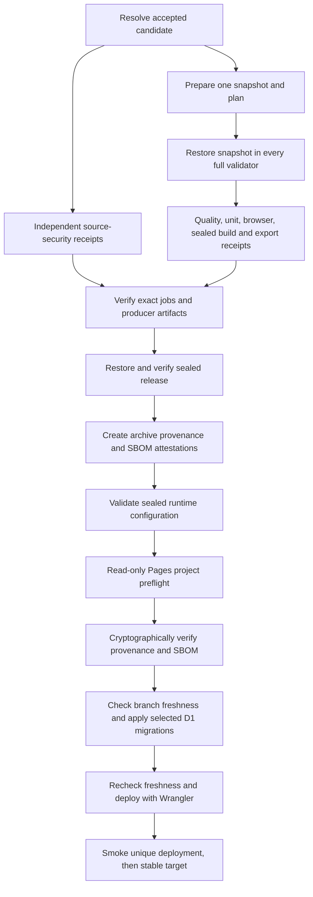

# Deployment

Smart Portfolio is deployed to Cloudflare Pages by GitHub Actions. The repository produces a Next.js static export and supplies two Cloudflare Pages Functions at `/api/contact/verify` and `/api/contact`.

This guide defines the deployment architecture and initial configuration. Use [Operations](OPERATIONS.md) for recurring releases, monitoring, rollback, and incident response. Use [Troubleshooting](../development/TROUBLESHOOTING.md) when a local or hosted check fails.

## Current deployment targets

These are the reviewed targets for this deployed portfolio. They are not generic defaults for a fork or a different Cloudflare account; see [Set up or restore a deployment](#set-up-or-restore-a-deployment) before changing them.

| Purpose | Address | Repository use |
| --- | --- | --- |
| Public custom domain | `https://nicolasmgioanni.dev` | Primary visitor address |
| Cloudflare-assigned production domain | `https://smart-portfolio-bds.pages.dev` | Production polling and smoke tests |
| Stable `develop` preview | `https://develop.smart-portfolio-bds.pages.dev` | Preview polling and smoke tests |

HTTP checks on 2026-08-27 observed successful responses from the public custom domain and both `pages.dev` targets. This is a point-in-time observation, not repository verification of current domain, DNS, certificate, or Pages state. The workflow deliberately uses the assigned Pages domain for automation so a custom-domain or DNS change cannot redirect deployment verification.

`www.nicolasmgioanni.dev` is present in the production hostname and origin allowlists. Domain attachment, redirect behavior, TLS state, and DNS records are Cloudflare account configuration rather than repository configuration and must be checked separately.

## Ownership and trust boundaries

The checked-in deployment path is `.github/workflows/ci.yml`. It builds and deploys through Wrangler Direct Upload. There is no Vercel, Netlify, or Cloudflare Git-integration configuration in the repository.

The repository can verify:

- Workflow triggers, job permissions, conditions, and commands.
- The exact Pages project name and assigned domain required by the workflow.
- Static output, Function routing, security headers, content-version metadata, and artifact-integrity logic.
- That deployment credentials are requested only by the deploy job.

The repository cannot verify Cloudflare or GitHub dashboard state. Operators must separately confirm:

- Cloudflare Pages Git integration remains disconnected.
- No legacy provider continues to publish the custom domain.
- Cloudflare runtime secrets and separate D1 bindings exist in the correct production and preview environments.
- WAF rate limiting covers both contact endpoints, and the selected Cloudflare plan or provider-compatible control preserves the JSON API contract.
- The tracked [permanent-branch ruleset](../../.github/rulesets/protect-permanent-branches.json) declares one active `protect-permanent-branches` ruleset for exactly `main` and `develop`, with deletion and non-fast-forward protection and no bypass actors. GitHub readback reverified the matching live ruleset on 2026-10-12. The JSON records the configuration but cannot prove or change future live state.
- Current GitHub branch-response evidence establishes that `main` is protected and has a `verify` requirement from GitHub Actions app `15368`. A signed-in, read-only settings inspection on 2026-10-12 confirmed required pull-request changes, up-to-date branches, no required review count, administrator enforcement, and disabled force pushes and deletion. The detailed classic-protection API remained inaccessible; this observation came from the settings UI and changed no controls. Do not replace or weaken the intended classic policy; the limited permanent-branch ruleset permits the guarded ordinary `develop` heartbeat. Re-verify both external controls after any GitHub policy change.
- Custom-domain bindings, redirects, certificates, and DNS remain healthy.

Provider-dashboard uploads and deploy hooks bypass the repository quality gate and are not part of the supported release path.

## Trigger and branch behavior

`resolve-candidate` admits an eligible event and workflow revision before checkout, then records one immutable candidate. `prepare-content` creates the plan and accepted snapshot. A full plan fans out to application validation; the independent source-security jobs fan out directly from resolution. `verify` accepts only the required successful jobs and their original evidence artifacts. `deploy-<target>` is conditional on that acceptance. The schedule-only `develop-schedule-heartbeat` is independent.

| Event | Candidate and content | Application path | Deployment |
| --- | --- | --- | --- |
| Pull request targeting `main` or `develop` | Event merge SHA and checked-in templates | Full validation and sealed candidate checks | Never |
| Push to `develop` | Exact pushed SHA and one strict remote workbook snapshot | Full validation | `develop` preview |
| Push to `main` | Exact pushed SHA and one strict remote workbook snapshot | Full validation | Production |
| Daily schedule at `17 13 * * *` | Trusted `main`, one strict remote snapshot, and deployed-identity comparison | Full only when not obsolete or proven unchanged | Production only for a full accepted plan |
| Manual dispatch, `force_deploy=true` | Trusted `main` and one strict remote snapshot | Full validation | Production after acceptance |
| Manual dispatch, `force_deploy=false` | Trusted `main`, one strict remote snapshot, and deployed-identity comparison | Full only when not proven unchanged | Production only for a full accepted plan |

`force_deploy` is a required boolean input and defaults to `true`. It bypasses only the exact-candidate no-op optimization. It does not bypass content validation, documentation validation, lint, typecheck, tests, build, artifact verification, current-branch checks, Wrangler, or post-deployment smoke checks.

Scheduled and manual runs explicitly execute the trusted `main` workflow. Pushes use `main` or `develop`; pull requests use the GitHub merge candidate and never receive workbook or Cloudflare deployment credentials. A stale permanent-branch candidate becomes an explicit obsolete plan. A scheduled or ordinary manual candidate is unchanged only when a validated deployable-v2 identity has the same content, source, target, public-build inputs, and GitHub Actions producer kind. A missing identity (`404`), legacy v1, or valid but non-equivalent v2 identity selects full validation. A malformed, failed, any other non-200 response, or unavailable observation fails closed. Producer ordering protects the later serialized deployment decision and does not make a current run ineligible for this comparison.

Every full plan runs `quality`, `unit-integration`, two Chromium functional shards, Linux visual regression, Firefox critical, WebKit critical, and WebKit mobile Research/Projects coverage, `build-and-package`, and `export-check` from the same restored snapshot. `security-tools`, `security-scans`, `codeql`, and `infrastructure` run for every accepted candidate, including obsolete and unchanged plans; `dependency-review` is also required for pull requests. All source-security jobs write independent source receipts, and `verify` reads their exact producer artifacts rather than inferring success from job names.

The workflow uses Node `22.23.3`, Next `16.4.0`, Wrangler `4.148.0`, and the pinned Miniflare pair in the lockfile. The security path checks workflows with checksum-verified actionlint, scans complete Git history with checksum-verified Gitleaks and Zizmor, and scans the exact sealed full-plan release directory with the same pinned Gitleaks binary before it can upload. It runs JavaScript/TypeScript CodeQL `security-extended` in `build-mode: none`, checks SARIF fail-closed, and uses GitHub dependency review on pull requests. These repository checks do not prove that an external environment, protection rule, or provider setting is enabled.

## Permissions and credentials

The workflow-level permission is:

```yaml
permissions:
  contents: read
```

Ordinary jobs retain read-only repository access. The `codeql` job adds only `security-events: write` to upload its already-validated SARIF result; pull-request dependency review adds only `pull-requests: read`. Cloudflare deployment authority remains isolated to the restricted API token passed directly to Wrangler, not to a repository write permission.

The schedule-only heartbeat job is the sole exception. It declares `contents: write`, but the checked-in job is coded and guarded to update only `.github/schedule-heartbeat` on the existing `develop` branch after the inactivity threshold is met. That source-level guard and the tracked ruleset test do not replace independently verified external branch or ruleset protection.

### GitHub repository variables

| Variable | Required value or purpose |
| --- | --- |
| `CLOUDFLARE_PAGES_PROJECT_NAME` | Must equal `smart-portfolio` |
| `CLOUDFLARE_PAGES_DOMAIN` | Must equal `smart-portfolio-bds.pages.dev` |
| `NEXT_PUBLIC_TURNSTILE_SITE_KEY` | Public production widget key compiled into the production build |
| `NEXT_PUBLIC_TURNSTILE_PREVIEW_SITE_KEY` | Optional public preview widget key, with no production fallback |

The workflow fails before downloading the workbook if either Pages target variable differs from the reviewed value.

### GitHub Actions secrets

| Secret | Purpose |
| --- | --- |
| `PORTFOLIO_WORKBOOK_URL` | Anonymous HTTPS XLSX source, stored as a secret for runner-log redaction |
| `CLOUDFLARE_API_TOKEN` | Restricted Cloudflare token with Pages and D1 edit authority for this account |
| `CLOUDFLARE_ACCOUNT_ID` | Target Cloudflare account identifier |

The workbook source is supplied only to non-PR content generation. Cloudflare deployment secrets are supplied only to the deploy job.

### Cloudflare runtime secrets

Configure these as encrypted Pages secrets for each environment that supports the contact flow:

- `TURNSTILE_SECRET_KEY`
- `RESEND_API_KEY`
- `CONTACT_RECIPIENT_EMAIL`

Do not add a separate verification-ticket key. The Function derives its signing key from `TURNSTILE_SECRET_KEY` with domain-separated HKDF.

### Reviewed non-secret Pages variables

`wrangler.jsonc` is the source of truth for:

- `TURNSTILE_ALLOWED_HOSTNAMES`
- `CONTACT_ALLOWED_ORIGINS`
- `CONTACT_FROM_EMAIL`
- `CONTACT_REPLY_TO_EMAIL`

The top-level values cover production. `env.preview.vars` narrows the preview environment to the stable `develop` hostname and origin. The file also pins `pages_build_output_dir` to `./out` and the Cloudflare compatibility date.

### D1 contact-rate bindings

`wrangler.jsonc` declares `CONTACT_RATE_LIMIT_DB` twice:

- top-level `smart-portfolio-contact-rate-limit-production` for production;
- `env.preview` `smart-portfolio-contact-rate-limit-preview` for every Pages preview deployment.

The tracked `database_id` values identify the reviewed live resources. Do not recreate those existing databases during an audit. A deliberate database replacement must use new, separate production and preview databases. Review the resulting UUIDs, update the matching names and IDs in `wrangler.jsonc`, and commit that configuration change before deployment. If a database name changes, update the corresponding hard-coded migration targets in `.github/workflows/ci.yml` and their configuration/workflow contract tests in the same reviewed change.

Do not reuse or copy the current live IDs for a different account, and do not commit a shared ID for both environments. `preview_database_id: contact-rate-limit-local` is a local-emulation identifier, not a remote database. The deploy job rejects missing, all-zero, or shared remote IDs, then applies tracked migrations to the selected database before uploading Pages.

## Set up or restore a deployment

The tracked workflow uses Cloudflare Pages Direct Upload. The current Cloudflare dashboard state is external and unverified by the repository. Choose the path that matches the target before changing provider settings.

### Restore or audit the existing Smart Portfolio service

1. Confirm that the Pages Direct Upload project is named `smart-portfolio`, uses `main` as its production branch, and retains its assigned `smart-portfolio-bds.pages.dev` hostname. Do not create a second project to imitate that hostname.
2. Keep Cloudflare Git integration disconnected. GitHub Actions owns the content fetch, quality gate, build, and upload.
3. Add the four repository variables and three Actions secrets listed above. Restrict the Cloudflare token to the target account with Pages edit and D1 edit; do not grant unrelated zone or account authority.
4. Confirm the tracked production and preview D1 UUIDs resolve to the intended distinct databases. If provisioning replacements, update and commit the reviewed configuration. Keep the binding name exactly `CONTACT_RATE_LIMIT_DB` in both environments.
5. Apply the reviewed non-secret values from `wrangler.jsonc` and configure encrypted runtime secrets separately for production and preview.
6. Configure Managed Turnstile widgets for their exact production or preview hostnames. Production credentials must not authorize local-development hosts. The application supplies action `portfolio_contact`, the submission UUID as `cData`, `execution: "render"`, and `appearance: "always"` for the visible upfront gate. Keep those values aligned with the server checks and do not enable a separate interactive endpoint challenge.
7. Verify the Resend sending identity, check its suppression and bounce state, and keep the owner recipient value server-only.
8. Configure external WAF rate limiting for both JSON endpoints. A combined expression may match:

   ```text
   http.request.uri.path in {"/api/contact/verify" "/api/contact"}
   ```

   Count by source IP. A Free-plan baseline of 5 requests per 10 seconds with a 10-second block can reduce abuse, but Cloudflare custom rate-limit responses require Pro or higher. Free-plan rate limiting therefore cannot guarantee the required `application/json` response and must not be documented as fully satisfying the contact API contract. On Pro or higher, explicitly configure the rate-limit or block action for both endpoints with the required JSON response and verify the live status, content type, and body. Plan eligibility alone does not satisfy the prerequisite. Otherwise, use another provider-compatible control that preserves the JSON contract. Do not use an interactive Managed Challenge on either endpoint.
9. Confirm the active custom-domain, redirect, DNS, and TLS state in Cloudflare. The repository allowlists do not attach a domain.
10. Push the reviewed change to `develop`. Confirm the workflow applies all pending migrations, including `0002_contact_payload_fingerprint.sql` and `0003_contact_delivery_rendering.sql`, to the preview database before Pages upload. Complete the preview gate, observe its automatic transition or use Continue, and inspect the three data-entry steps, two acknowledgments, and 500-character limit without selecting Send request. This may consume a Turnstile token, but it must not call `/api/contact`, reserve D1 quota, or send email. Reserve any delivery test for a separately authorized owned mailbox.
11. Merge the verified change to `main` only after the preview and pull-request checks pass. Confirm the same migrations are applied to the production database before Pages upload, then perform the automated and manual no-delivery checks described below.

The WAF rule, active Cloudflare plan, runtime secret presence, branch or ruleset protection, and provider integration state are external prerequisites. Their desired values are documented here, but their current live state is unverified by the tracked files.

### Adapt a fork or a different Cloudflare account

The current workflow intentionally rejects a Pages project or assigned domain other than `smart-portfolio` and `smart-portfolio-bds.pages.dev`. `wrangler.jsonc` also contains this portfolio's project name, D1 IDs, allowed hostnames and origins, sender identity, and reply-to address. A new account cannot deploy safely by only changing dashboard variables or copying these live resource IDs.

1. Create a [Pages Direct Upload project](https://developers.cloudflare.com/pages/get-started/direct-upload/) in the new account with `main` as its production branch. Record its Cloudflare-assigned hostname; dashboard drag-and-drop uploads do not compile Pages Functions, so deployment must continue through Wrangler from the repository root.
2. Create a dedicated configuration change and update the reviewed source together: the immutable project and assigned-domain checks in `.github/workflows/ci.yml`; the Pages project; separate D1 database names and IDs; fixed migration target names and workflow-contract tests; hostname and origin allowlists; sender identity; reply-to address; and any application public-domain, canonical URL, or branding assumptions.
3. Create two new D1 databases in the new account, one for production and one for preview. Run the following command once for each distinct reviewed database name, then record only its reviewed ID in the matching `wrangler.jsonc` entry:

   ```bash
   npx --no-install wrangler d1 create <database-name> --location wnam
   ```

   Keep `CONTACT_RATE_LIMIT_DB` as the binding name and retain the local emulator ID for local Pages development.
4. Configure the new repository's project and assigned-domain variables to match the updated workflow source. Add its workbook locator, Cloudflare account ID, and restricted deployment token as GitHub Actions secrets. Configure the production and preview browser keys as repository variables.
5. Create separate production and preview Turnstile widgets, runtime secrets, recipient settings, sender identity, domain/DNS/TLS configuration, and a provider-compatible JSON-preserving rate limit for both contact endpoints. Review those external controls independently.
6. Run the local and pull-request checks for the configuration change. Push the reviewed source to `develop` to establish and verify the new preview, then merge it into `main` for production. A pull request itself never deploys; it uses checked-in templates and only verifies the change.

Do not change the deployment account or public identity as an unreviewed dashboard-only action. The repository source, CI target checks, Pages configuration, and external provider state are one release boundary.

## First deployment and manual release

1. Complete the matching setup path above and confirm the configuration change passes a pull-request check. Pull requests are verification-only and never deploy.
2. Push the reviewed change to `develop` to run full verification and deploy the stable preview. Complete the preview checks in [Operations](OPERATIONS.md#preview-a-branch-change).
3. Merge the approved change into `main` to run full verification and deploy production. The workflow checks the latest `main` candidate again immediately before Wrangler uploads.
4. Optional, after a reviewed commit is already on `main`: for a first deployment, an intentional rebuild, or a retry after correcting external configuration, use **Actions → CI → Run workflow**, select `main`, and set `force_deploy=true`. The run uses the exact admitted `main` event candidate; stale checking must still pass. Forced dispatch then runs the full verification, exact-artifact, migration, deployment, and smoke-test path.
5. Use `force_deploy=false` only when a content-hash and commit-SHA no-op is acceptable. Follow [Operations](OPERATIONS.md) for the ongoing manual release, verification, monitoring, and rollback procedures.

## Strict content input

Non-PR candidates set `PORTFOLIO_REQUIRE_REMOTE_CONTENT=true` and accept one complete anonymous workbook snapshot. The generator permits at most two independent 15-second attempts separated by one fixed second for retryable transport failures. It does not receive Google account access, OAuth tokens, a service account, a Drive connector, or a Sheets API client.

The workbook must expose exactly the nine expected visible worksheets. The generator rejects missing, extra, duplicate-normalized, hidden, or very-hidden worksheets, malformed headers or rows, invalid file data, schema validation failures, timeouts, and responses above the configured size limit. Strict mode has no template fallback.

Pull requests do not receive the workbook source. They generate and validate content from the checked-in templates.

See [Content Pipeline](../content/CONTENT_PIPELINE.md) and [Content Sheet Schema](../content/CONTENT_SHEET_SCHEMA.md) for the complete workbook and normalization contract.

## Single-snapshot, exact-artifact pipeline



The exact job graph, receipt contracts, and hosted-evidence limits are maintained in [CI input and evidence contracts](../quality/CI_CONTRACTS.md). `npm run build:generated` invokes Next.js, whose local build-completion adapter normalizes any Windows-emitted nested segment-cache filenames to Next's flat static-export URL layout, and then writes the content version without running the `prebuild` content generator. The normalization is a no-op on the already-flat Linux output and fails on malformed trees or collisions. This keeps generation at one accepted workbook snapshot even if its download needs the single bounded retry. The deploy job does not rebuild or download the workbook.

`quality` runs documentation validation, ESLint with zero warnings, and strict TypeScript checking. The independent `security-scans` job runs the dependency audit for every plan, including no-ops. `unit-integration` runs the complete Vitest suite. Browser discovery creates one complete identity set; its two Chromium functional shards, the separate visual selection, and Firefox critical, WebKit critical, and WebKit mobile Research/Projects selections must cover their exact assignments. `build-and-package` builds once from the accepted bytes, compiles Functions, creates an artifact manifest and CycloneDX SBOM, then seals the release. It scans that exact sealed directory with pinned Gitleaks before uploading either its scan receipt or release artifact; the aggregate requires the distinct scan receipt bound to the sealed manifest. `export-check` restores that same sealed package and validates static output and compiled Pages runtime. Pull-request verification is deliberately deployment-free, but it uses this complete application path rather than a reduced priority tier.

Consumers restore the original snapshot artifact by immutable same-run ID, provider digest, role, record digest, and producer identity. They do not regenerate content. A consumer rerun continues to use the original producer; a regenerated snapshot, missing or expired artifact, changed lockfile or public-build input, or changed restored bytes invalidates affected receipts and requires a full affected rerun.

For production and preview builds, `DEPLOYMENT_COMMIT_SHA` binds deployment metadata to the candidate. Each build selects only its effective production or preview browser Turnstile key; preview maps its optional key into `NEXT_PUBLIC_TURNSTILE_SITE_KEY`.

The deploy job checks out the same SHA so `functions/`, `migrations/`, and `wrangler.jsonc` match the tested source. The trusted workflow creates GitHub provenance and SBOM attestations for the restored, validated archive before invoking the deployment command. Before that command makes any provider call, it admits the sealed runtime configuration as the reviewed narrow capability boundary, including the selected target's D1 binding and the sealed toolchain compatibility settings. The command then makes one bounded read-only authenticated `GET` for the exact Pages project in the configured account. The preflight accepts only the reviewed `smart-portfolio` Direct Upload project, `smart-portfolio-bds.pages.dev` subdomain, and `main` production branch; it rejects redirects, malformed or oversized responses, timeouts, and Git-connected projects without logging provider details. After that read-only preflight, the command cryptographically verifies the attestations against the candidate repository, source, workflow certificate, signer digest, and OIDC issuer before D1 migration or Wrangler upload. It holds a non-cancelling target-specific concurrency lock, checks branch freshness before and after migrations, validates the selected D1 binding, applies pending migrations, then accepts only the exact pinned-Wrangler structured deployment result. It smokes the returned unique Pages host before confirming its identity, then smokes the stable assigned target and confirms the final deployed identity. Migration targeting uses fixed database names rather than an interchangeable binding name.

## D1 migration lifecycle

Tracked SQL files under `migrations/` are append-only deployment inputs. `0001_contact_rate_reservations.sql` creates the four-column reservation table plus indexes for email-and-expiry lookup and expiry cleanup. `0002_contact_payload_fingerprint.sql` adds the keyed payload-fingerprint column used to reject changed same-ID retries without storing raw fields. `0003_contact_delivery_rendering.sql` adds opaque delivery-configuration and renderer-version fields. Existing rows retain `NULL` in the new fields and fail closed on retry, avoiding a changed configuration or template rerender of an uncertain prior send. Timestamps are Unix epoch seconds. D1 records successful files in its migration ledger, so a later deploy applies only pending migrations.

The workflow commands are:

```powershell
npx --no-install wrangler d1 migrations apply smart-portfolio-contact-rate-limit-preview --env preview --remote
npx --no-install wrangler d1 migrations apply smart-portfolio-contact-rate-limit-production --remote
```

The release process must migrate and verify preview before production. CI routes preview and production deployments independently, so this ordering is an operator release requirement rather than a workflow-enforced invariant. Never use `--local` for a release migration, never point preview at the production ID, and never edit an already-applied SQL file. Add a new numbered migration for a future schema change. Review destructive SQL separately and design migrations to remain compatible with the previously deployed Function while the Pages upload is in flight.

## Deployment metadata

### Content version

Every new build writes `out/content-version.json` with the v2 identity:

```json
{
  "schemaVersion": 2,
  "contentHash": "<sha256>",
  "commitSha": "<40-character Git SHA>",
  "target": "<local|preview|production>",
  "publicBuildInputDigest": "<sha256>",
  "producer": {
    "kind": "github-actions",
    "runId": "<GitHub run ID>",
    "runNumber": 123,
    "attempt": 1
  },
  "generatedAt": "<content generation timestamp>",
  "deployedAt": "<build timestamp>"
}
```

The `contentHash` covers the canonical normalized content subset and excludes volatile metadata. `publicBuildInputDigest` binds the target, candidate SHA, lockfile, public Wrangler configuration digest, Node/Next/Wrangler versions, and a hash of the effective browser Turnstile key. It never publishes the key itself. Preview maps its preview variable into the one runtime input, `NEXT_PUBLIC_TURNSTILE_SITE_KEY`.

The producer identifies the build-and-package job, not the earlier content-preparation job. Release ordering compares `runNumber` and then `attempt`; a local build records `{ "kind": "local", "runId": "local", "runNumber": null, "attempt": null }` and cannot be deployed. The reader accepts existing v1 metadata for migration, but v1 cannot establish a no-op equivalence or producer order. A malformed or ambiguous v2 identity fails closed.

`public/_headers` marks `/content-version.json` as non-cacheable. Every deployed-identity observation, including an exact deployment host and a stable branch alias, also sends no-cache headers and a unique cache-busting query. It treats `404` as no prior deployment, rejects redirects for identity metadata, and fails closed on other inaccessible or malformed responses.

### Bounded sealed-release package

The release foundation separates the exact-artifact work into explicit commands. These commands do not download content, run the normal quality gates, deploy, migrate D1, send email, or sign an unsigned package:

```bash
npm run release:build -- --snapshot <accepted-generated-json> --snapshot-sha <sha256> --snapshot-record-digest <sha256> --sha <candidate-sha> --target <local|preview|production> --public-build-input-digest <sha256> --generation <local|run-id:run-number:attempt>
npm run release:compile -- --out out --sha <candidate-sha>
npm run release:package -- --directory <release-dir>/release --out out --snapshot-sha <sha256> --snapshot-record-digest <sha256> --sha <candidate-sha> --target <target> --public-build-input-digest <sha256> --generation <generation>
npm run release:runtime -- --directory <release-dir>/release
```

`release:build` verifies the accepted generated JSON bytes, carries the accepted snapshot-record digest into the later sealed candidate, derives the target-specific public fingerprint, and runs `build:generated` once. The verified snapshot record separately binds the preparation producer; the `--generation` value belongs only to the build/package producer. A build rerun therefore creates a new release identity and package even when source and snapshot bytes are unchanged.

`release:compile` parses the completed HTML export to hash only real inline script nodes, then reads the emitted worker, configuration, and routes through bounded no-follow descriptors before validating and writing those exact bytes into `out/`. It uses the pinned local Wrangler CLI to compile the two reviewed Functions and routing file, and creates the static artifact manifest. `release:package` seals exactly `out/`, `wrangler.jsonc`, numbered migrations, a CycloneDX SBOM, and the candidate identity. The package rejects symlinks, traversal, private deployment inputs in `out/`, unexpected entries, configuration or migration substitutions, and replacement of an unowned release directory.

`release:runtime` verifies the sealed package before and after running the compiled worker in local Miniflare and a browser check through pinned `wrangler pages dev`. It uses the packaged `out/` and configuration so the command can check an exact downloaded candidate without modifying its compiled public-key bytes. These checks use isolated Turnstile/D1 fixtures and prohibit provider email delivery; they are not evidence of live Cloudflare, D1, email, or environment settings. A full CI plan invokes the accepted-snapshot build, compile/package, and packaged-runtime stages with explicit `RELEASE_TARGET` identities. Ordinary callers that omit those release identities retain schema-v1 output; v1 remains ineligible to establish no-op equivalence or release-producer ordering.

### Artifact integrity

Before upload, `scripts/artifactIntegrity.mjs` creates `out/artifact-integrity.json`. It records:

- Schema version `1`.
- Algorithm `sha256`.
- The candidate commit SHA.
- A sorted record for every other artifact file, including its relative path, byte size, and SHA-256 digest.

The creator rejects symbolic links and unsupported entries. Verification requires the expected commit SHA, agreement with `content-version.json`, the same file count and ordered paths, and exact size and digest matches. The sealed release contains `out/`, the reviewed Wrangler configuration, numbered migrations, the SBOM, candidate identity, and release manifest. Its immutable Actions artifact is identified by original producer run and attempt and is retained for three days; it is not a durable release archive.

The integrity manifest covers `out/`, including the compiled worker and reviewed routing file. The sealed package also binds the public Wrangler configuration and numbered migrations outside the public static directory.

## Exact automated smoke scope

After Wrangler returns, `scripts/checkDeployedContent.mjs` tests the unique deployment host returned by the pinned structured result and then the stable assigned-domain alias for the deployed branch. These are unauthenticated `GET` checks for the canonical production alias or current `develop` preview alias. It retries up to 10 times, waits 5 seconds between attempts, uses cache-busting queries, applies a 20-second timeout to each request, and rejects redirects for every verified resource.

Each successful attempt proves:

1. `/` returns a successful `text/html` response whose bytes exactly match sealed `index.html`, whose effective route headers exactly match sealed `_headers` for CSP, permissions policy, referrer policy, HSTS, content-type protection, and frame denial, and whose canonical link resolves to `https://nicolasgioanni.dev/` without a query string or fragment.
2. `/robots.txt` returns a successful response whose content type includes `text/plain`, and its text exactly matches `robots.txt` in the verified local artifact.
3. `/sitemap.xml` returns a successful response with an XML-compatible content type, and its text exactly matches `sitemap.xml` in the verified local artifact.
4. `/content-version.json` contains the expected content hash and candidate commit SHA, with `Cache-Control: no-store` and `Pragma: no-cache`.
5. `/artifact-integrity.json` exactly matches the verified local manifest and has the same non-cacheable metadata headers.
6. `GET /api/contact/verify` returns HTTP `405`, an `application/json` content type, `{ "ok": false, "error": "method_not_allowed" }`, `Cache-Control: no-store`, `Referrer-Policy: no-referrer`, and `X-Content-Type-Options: nosniff`.
7. `GET /api/contact` returns the same exact method-rejection and restrictive-header contract.

The automated smoke test does not request every static route, test the custom domain, submit a valid Turnstile token, inspect D1 rows, exercise DNS validation, send email, exercise WAF rules, or prove end-to-end contact delivery. Those checks remain part of release and operations verification.

## Routing and response headers

The Pages Functions compiler emits sealed `out/_routes.json` only after it matches both the reviewed `public/_routes.json` source intent and the static output route contract. The sealed route file invokes Pages Functions only for:

- `/api/contact/verify`
- `/api/contact`

All other route and asset requests remain on the static Pages path. The sealed compiler emits `out/_headers` from the reviewed `public/_headers` source; its static Content Security Policy, permissions policy, referrer policy, HSTS, content-type protection, frame denial, and metadata cache rules are the exact values compared by assigned-alias smoke.

Pages `_headers` rules do not apply to Function responses. Both Functions set their own JSON content type, no-store caching, referrer, and content-type-sniffing headers.

## Failure and rollback behavior

Failure behavior depends on where the run stops:

- A stale candidate, invalid target, content failure, quality-gate failure, build failure, artifact failure, or pre-migration branch mismatch does not change the active Pages deployment or D1 schema.
- A D1 target-validation failure changes neither database nor Pages. A migration failure rolls back the failing migration and stops before Pages upload; earlier migrations may already be active.
- A successful migration followed by a Pages upload failure leaves the forward-compatible schema active while the prior Pages deployment normally remains active. D1 migrations are not undone by Pages rollback.
- A Wrangler failure normally leaves the prior successful deployment active, but the Cloudflare result remains authoritative.
- A smoke failure occurs only after Wrangler has successfully created the candidate deployment. The candidate may already be serving through the stable alias, and a failed GitHub job does not undo or roll back that upload. Identify the active deployment from Cloudflare history and live metadata before taking recovery action.
- A changed workbook hash that fails before deployment differs from the active manifest, so a later scheduled run attempts it again.
- A code-only candidate can have the same content hash as production. Its differing commit SHA makes a later scheduled or non-forced run retry the complete verified deployment path automatically.

The three-day GitHub Actions artifact is not a long-term rollback archive. Use Cloudflare Pages deployment history for an authorized provider rollback, or restore the intended source and workbook state and perform a forced green deployment. After either path, verify both assigned and custom domains and record the active content and commit metadata.

See [Operations](OPERATIONS.md) for the release, incident, and rollback runbooks.

## Permanent-branch protection and heartbeat

`main` and `develop` are permanent branches. Never delete, rename, force-update, or recreate either their local or remote refs, and never weaken their protection. Exclude both branches from cleanup work. The checked-in [protect-permanent-branches ruleset](../../.github/rulesets/protect-permanent-branches.json) records the one active ruleset's exact payload: it applies only to `refs/heads/main` and `refs/heads/develop`, has no bypass actors, and blocks only deletion and non-fast-forward updates. It deliberately does not restrict ordinary updates or branch creation.

The following classic `main` policy was observed through the signed-in, read-only GitHub UI on 2026-10-12:

1. Pull-request-based changes with the `verify` status required; require the branch to be current before merge.
2. No human review approval is required by this policy.
3. Force-push and branch deletion are blocked.
4. GitHub Actions has no bypass to write deployment state to `main`.

The ruleset supplements rather than replaces the classic `main` policy. GitHub readback reverified the matching live ruleset on 2026-10-12. A committed JSON payload, its local test, and the point-in-time classic-policy observation do not establish future live state, so operators must inspect both the active GitHub ruleset and the classic `main` policy after every governance change.

The daily schedule also starts `develop-schedule-heartbeat`. It compares the newest activity on `main` and `develop`. If neither has activity within 30 days, the checked-in job first confirms that remote `develop` already exists, then writes only `.github/schedule-heartbeat`, verifies that no other path changed, and commits as `github-actions[bot]`. It checks that `develop` did not change while the job prepared the commit and uses a normal non-force push to `develop`; a concurrent update is rejected rather than retried or overwritten. The job is coded to make no other ref update, uses its own non-canceling concurrency group, and cannot deploy. The permanent-branch ruleset allows this guarded ordinary fast-forward while preventing deletion and non-fast-forward rewrites.

## Related guides

- [Operations](OPERATIONS.md)
- [Testing](../quality/TESTING.md)
- [Troubleshooting](../development/TROUBLESHOOTING.md)
- [Security](../security/SECURITY.md)
- [Architecture](../architecture/ARCHITECTURE.md)
- [Local Development](../development/LOCAL_DEVELOPMENT.md)

The preparation change retains version-1 identity output for existing `build:generated` callers that do not declare `RELEASE_TARGET`. Only the sealed-release builder supplies the explicit target, public-input fingerprint, and producer fields needed for version 2. A PR candidate may record its Actions producer while remaining target `local` and ineligible for deployment. Offline local builds use the explicit local producer.

Preview public-key fingerprinting preserves the existing optional-key behavior: an absent preview key compiles an unavailable contact widget and never falls back to the production key. Its empty-value digest changes when a preview key is configured, invalidating deployment equivalence. Production still requires its configured public key.
