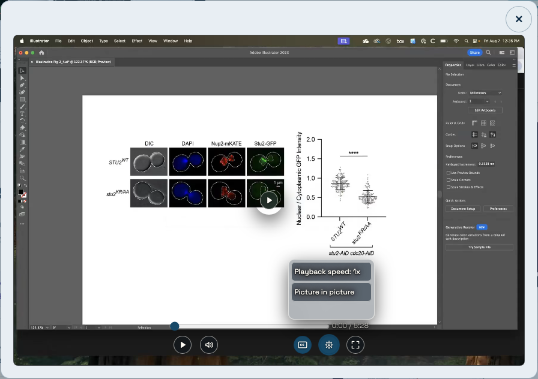
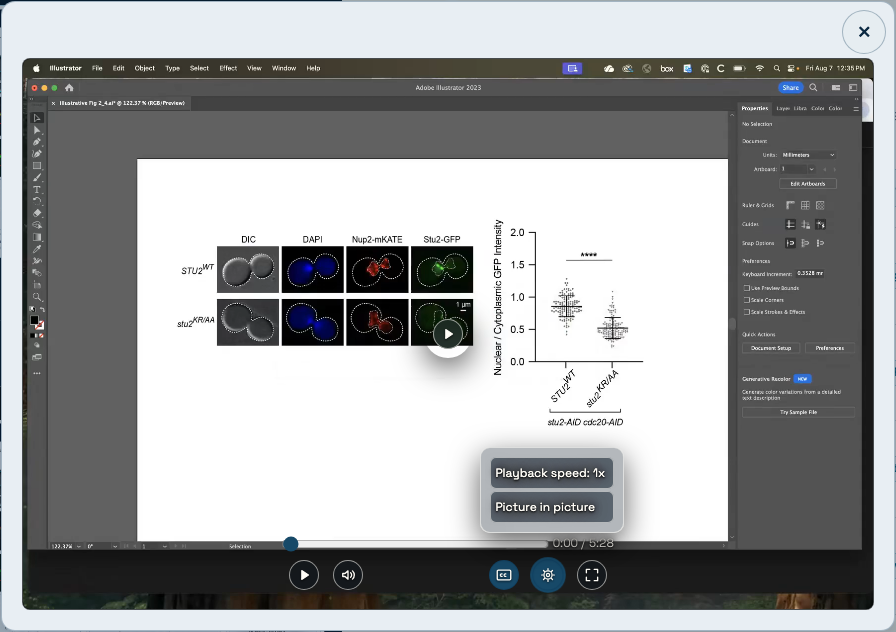
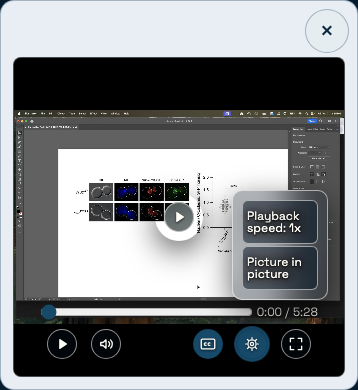

# Compact video settings evidence

Captured on 2026-11-11 in Chromium at 1280×800 desktop and 390×844 touch viewports, using the default Light palette and paused CytoCV video. Before images come from the live `nicolasmgioanni.dev/research` release at `da1199cd2527c7a05c1fca84d8f8d968979dbdcd`. After images come from this PR’s built working tree, using local templates and the repository’s pinned Pages static runtime with its generated CSP. They are implementation evidence, not a production-deployment claim.

## Desktop popup

| Before | After |
| --- | --- |
|  |  |

## Mobile popup

| Before | After |
| --- | --- |
|  |  |

The [focused speed view](after-desktop-speed-focus.png) shows the native range and its visible keyboard focus treatment. The clipped transition viewport reserves a five-pixel focus gutter; inactive views stay mounted but no longer determine the panel’s height.

## Measurements

Measurements use CSS pixels after finite transitions settle. The option gap is the distance between the active view’s lower edge and the outer panel’s lower edge; after the fix it includes the focus gutter and shell padding/border.

| Popup | Height before → after | Option gap before → after | Horizontal overflow before → after |
| --- | --- | --- | --- |
| Desktop | 101.19 → 86 | 30.19 → 10 | 2 → 0 |
| Mobile | 113.19 → 110 | 18.19 → 10 | 2 → 0 |

Both after captures have equal scroll/client width and equal scroll/client height. Genuine vertical scrolling is tested separately in a short coarse-pointer popup.

## Validation and limits

- Documentation, lint, type checking, all 1,199 unit/integration tests, and all 157 portable Chromium cases passed.
- After the final short-player containment refinement, the affected component/style checks passed 37/37, Chromium cases passed 3/3, and the scoped WebKit suite passed 5/5 again. Settings remain inside the player, and focus cannot horizontally pan the enhanced media frame.
- All five scoped WebKit mobile cases passed, including Back/focus restoration, constrained scrolling, captions, themes, opaque fallbacks, and fullscreen fallback.
- Static export and all eleven route/asset payload budgets passed without changing baseline ceilings. Captures were visually reviewed.
- The compiled Pages runtime also exposed exactly one Research heading and native player with controls and a default captions track when JavaScript was disabled.
- Linux-only zero-difference screenshots and the complete hosted release graph remain pending because GitHub Actions is blocked by an account billing lock. Baselines are unchanged.
- The original dependency baseline requires the separately reviewed [security prerequisite PR #131](https://github.com/nicolasgioanni/Smart-Porfolio/pull/131). Merge it before final combined-branch validation. Initial local Next commands stopped for its security upgrade notice; retries completed the reported checks. No audit gate or security threshold was bypassed.
- Physical iPhone Safari testing is pending; WebKit emulation does not establish hardware-specific behavior. The user requested PR preparation while billing is resolved later, so this work is not merged or deployed.
